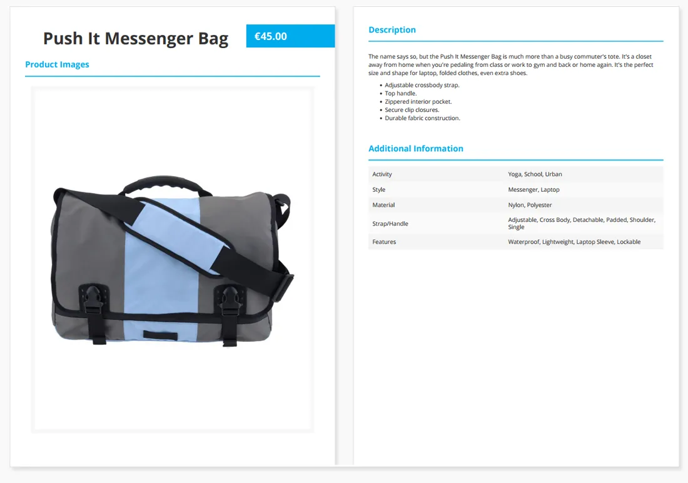
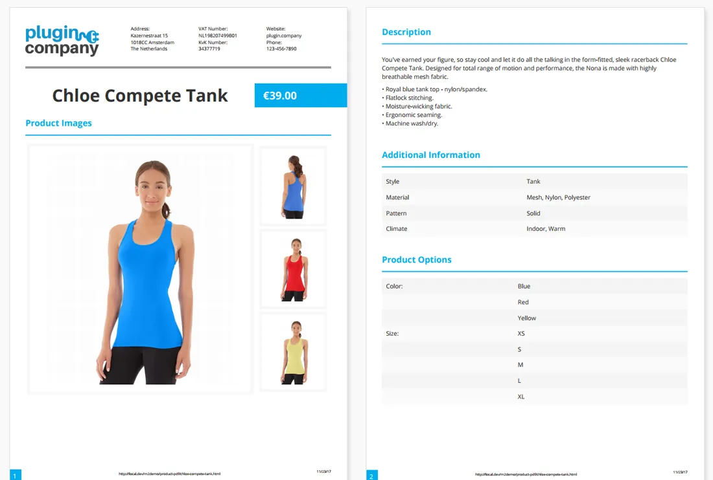
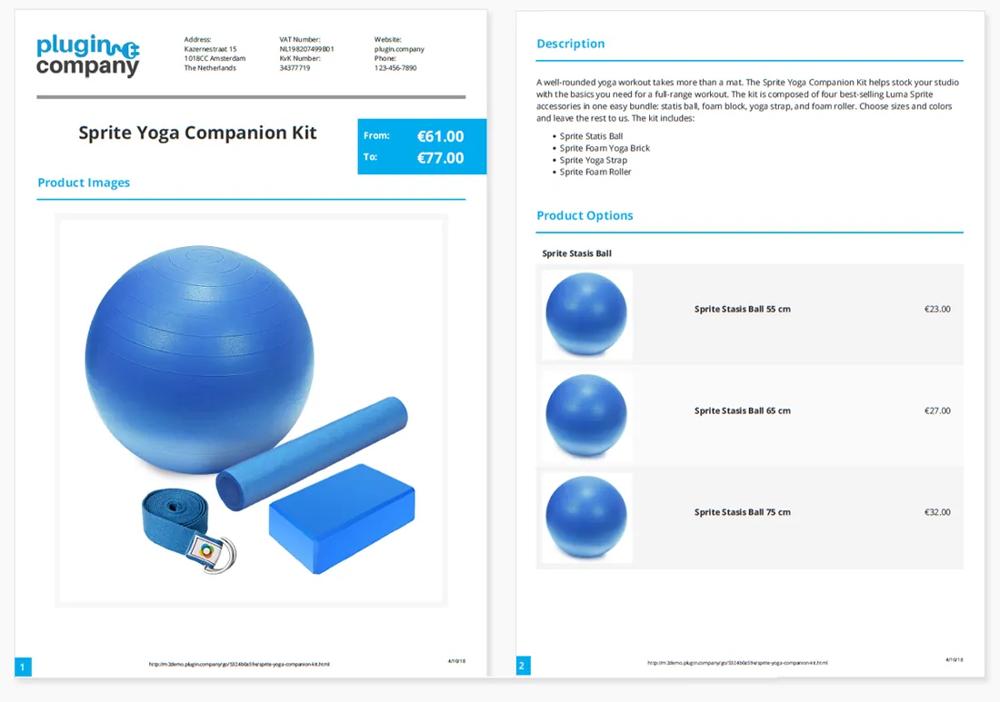
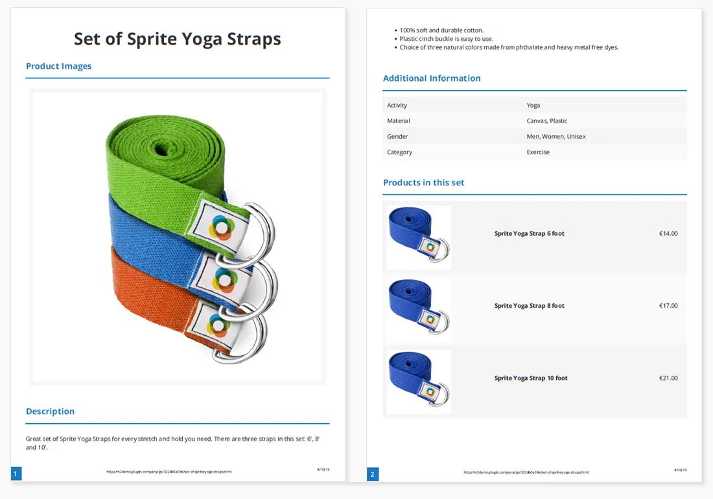

# Product Page PDF for Magento 2

**Lets customers download a PDF version of your Magento 2 product pages.**



Adds a PDF download to your product pages, so customers can save or print a clean copy of the product information.

The layout, content and design of the PDF are configured in the admin. Works with all product types.

> [!NOTE]
> Product Page PDF is free and open source under the MIT License (since 2026). Plugin Company no longer actively develops this extension, but issues and pull requests are welcome.

## Features

- PDF download of product pages for customers
- Supports all product types in Magento 2
- PDF icon or text link in any product page block
- Configurable PDF layout, content and design
- 40 Google fonts and seven image gallery layouts
- Show or hide descriptions, images, prices and custom options
- Drag-and-drop sort order of content sections
- Header with store logo and custom text columns
- Footer with product URL, time stamp and page numbers
- QR codes in the header and content area
- PDF download from the product page in the admin

## Screenshots

<table>
  <tr>
    <td width="50%" valign="top"><br><sub>Configurable product PDF example</sub></td>
    <td width="50%" valign="top"><br><sub>Bundle product PDF example</sub></td>
  </tr>
  <tr>
    <td width="50%" valign="top"><br><sub>Grouped product PDF example</sub></td>
    <td width="50%" valign="top"><br><sub>PDF download icon &amp; text link</sub></td>
  </tr>
  <tr>
    <td width="50%" valign="top"><br><sub>PDF download icon</sub></td>
    <td width="50%" valign="top"><br><sub>PDF download link</sub></td>
  </tr>
</table>

More screenshots are on the [product page](https://plugin.company/magento-extensions/product-page-pdf.html).

## Compatibility

- **Magento:** 2.1.x – 2.4.x
- **PHP:** 5.5 – 8.x (Composer constraint `~5.5.0|~5.6.0|~7.0|~7.1|~7.2|~8.0`)
- **Requires:** `mpdf/mpdf` 8.0.4 - 9.0.0, `mpdf/qrcode` ^1.1.1 (installed automatically by Composer)
- **Latest version:** 100.12.3 (released 2022-07-24)
- **Composer package:** `plugincompany/productpdf`
- **Module:** `PluginCompany_ProductPdf`

## Installation

### Composer (recommended)

Run in your Magento 2 root directory:

```bash
composer config repositories.plugin.company composer https://plugin.company/
composer require plugincompany/productpdf
bin/magento module:enable PluginCompany_ProductPdf
bin/magento setup:upgrade
```

The plugin.company Composer repository is public and points to the release tags of this GitHub repository; no account or credentials are needed. In production mode also run `bin/magento setup:di:compile` and `bin/magento setup:static-content:deploy`, then `bin/magento cache:flush`.

### Manual installation (ZIP)

Download the ZIP of the latest release from the [tags page](https://github.com/PluginCompany/magento2-product-page-pdf/tags) ([100.12.3](https://github.com/PluginCompany/magento2-product-page-pdf/archive/refs/tags/100.12.3.zip)) and copy its contents to `app/code/PluginCompany/ProductPdf/`, so that `app/code/PluginCompany/ProductPdf/registration.php` exists:

```bash
unzip magento2-product-page-pdf-100.12.3.zip
mkdir -p app/code/PluginCompany/ProductPdf
cp -R magento2-product-page-pdf-100.12.3/. app/code/PluginCompany/ProductPdf/
composer require "mpdf/mpdf:8.0.4 - 9.0.0" "mpdf/qrcode:^1.1.1"
bin/magento module:enable PluginCompany_ProductPdf
bin/magento setup:upgrade
```

The ZIP does not contain its Composer dependencies (`mpdf/mpdf`, `mpdf/qrcode`), hence the extra `composer require`.

See the [installation guide](docs/02-installing-the-extension.md) for the complete step-by-step instructions.

### Upgrading from a purchased copy

If you bought this extension from plugin.company before, you can switch to this open-source release without a license key. Your configuration and data stay as they are.

1. Keep the `plugin.company` repository entry in your `composer.json`: it now serves these GitHub releases with the same package names and version numbers. Credentials for plugin.company in `auth.json` are no longer needed.
2. Remove `plugincompany/licensemanager` from the `require` section of your `composer.json` if it is listed there.
3. Run `composer update plugincompany/productpdf plugincompany/licensemanager` (or simply `composer update`), then `bin/magento setup:upgrade`.

If you installed the ZIP into `app/code/`, replace the files in `app/code/PluginCompany/ProductPdf/` with this release. The License Manager module (`app/code/PluginCompany/LicenseManager/`) is not needed by these releases; once all your Plugin Company extensions are updated you can disable it with `bin/magento module:disable PluginCompany_LicenseManager`, delete the folder and run `bin/magento setup:upgrade`.

## Documentation

- [Documentation in this repository](docs/README.md) (Installation Guide, User Manual)
- Online documentation: <https://plugin.company/knowledge-base/docs/magento2-product-page-pdf/>
- Product page: <https://plugin.company/magento-extensions/product-page-pdf.html>
- Magento 1 / OpenMage version: [magento1-product-page-pdf](https://github.com/PluginCompany/magento1-product-page-pdf)

## Changelog

See [CHANGELOG.md](CHANGELOG.md) for the release history.

## Contributing

Found a bug or have an improvement? Please open an [issue](https://github.com/PluginCompany/magento2-product-page-pdf/issues) or send a [pull request](https://github.com/PluginCompany/magento2-product-page-pdf/pulls). Since the extension is no longer actively developed by Plugin Company, fixes from the community are the best way to keep it working on current Magento 2 and PHP versions.

## License

Plugin Company's code in this repository is released under the [MIT License](LICENSE), Copyright (c) 2014-2026 Plugin Company.

Bundled third-party libraries keep their own licenses; see [THIRD-PARTY-NOTICES.md](THIRD-PARTY-NOTICES.md) for the full list.

In particular:

- The Composer dependency **`mpdf/mpdf`** (8.0.4 - 9.0.0, not bundled) is licensed under **GPL-2.0-only**; a distribution of the combined work has to respect its license.
- A few files are copies or adaptations of Magento core code and keep their original Magento license headers (OSL-3.0 / AFL-3.0).
