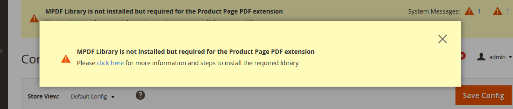

# Installing the Magento 2 Extension

## Download and Extract the Extension

Download the latest release of the extension from the [releases page](https://github.com/PluginCompany/magento2-product-page-pdf/releases) of its GitHub repository (the source code ZIP of the most recent version tag) and extract it locally to any folder. The extracted folder contains the module files, with `registration.php` in its root.

## Upload Files to Server

Connect to your server using SSH, SFTP or FTP.

Create the directory `app/code/PluginCompany/ProductPdf` in your Magento 2 root directory and copy the extracted files into it, so that `app/code/PluginCompany/ProductPdf/registration.php` exists. The `docs/` folder and the Markdown files (`README.md`, `CHANGELOG.md`) are not needed and can be left out.

## Enable the Extension

Enable the extension using the following command:

```bash
php bin/magento module:enable PluginCompany_ProductPdf
```

## Update the Database

Run the following upgrade command:

```bash
php bin/magento setup:upgrade
```

## Clean the Magento Cache

Clean the cache using the following command:

```bash
php bin/magento cache:clean
```

## Remove auto-generated classes

Remove all auto-generated classes using the following command:

```bash
rm -Rf ./generated/*
```

Or in Magento 2.0 and 2.1:

```bash
rm -Rf ./var/generation/*
```

## Run the Compiler

Run the dependency injection compilation command:

```bash
php bin/magento setup:di:compile
```

## Deploy Static View Files

Run the static content generation command:

```bash
php bin/magento setup:static-content:deploy
```

## <a id="install_using_composer"></a>Install the mPDF library using composer

Run the following command in your Magento root folder to install mPDF on your system. This library is used for rendering the PDFs in the browser:

```bash
php ./vendor/bin/composer require mpdf/mpdf
```

or:

```bash
composer require mpdf/mpdf
```

Now make sure that the web server user can write to the following directory:

```
vendor/mpdf
```

For example, if your web server runs as `www-data`, give that user ownership of the directory (use your own web server user and group):

```bash
chown -R www-data:www-data ./vendor/mpdf
```

Avoid making the directory world-writable (`chmod 777`).

The mPDF QR Code library is also required, which you can install using the following command:

```bash
php ./vendor/bin/composer require mpdf/qrcode
```

or:

```bash
composer require mpdf/qrcode
```

## Install the mPDF library through the Magento admin area

Depending on your configuration you might prefer to install the mPDF library directly in the Magento admin area. We have added an automatic installer to the extension for this purpose. Please note that the automatic installer might not work on all systems, so if you can install the library using the command line please do that instead.

### mPDF installation using the user interface

If the mPDF library isn't installed, you will see the following message in the admin panel:



Please click on the link and follow the steps to install the library.

---

[Documentation index](./README.md) · [README](../README.md) · [Online version](https://plugin.company/knowledge-base/docs/magento2-product-page-pdf/installation-guide/installing-the-extension/)
