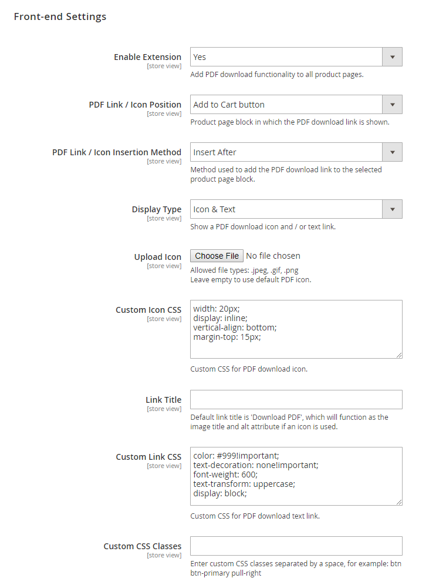

# Front-end Settings

In the Front-end Settings section you can:

- Enable the extension, which will add a PDF download link or icon to all front-end product pages.
- Select the product page block in which the PDF link or icon should be shown, or use a custom CSS selector.
- Choose if the PDF link or icon should be inserted before, after or prepended / appended to the selected product page block.
- Select the display type of the PDF download link, choosing between a text link, an icon, or and icon and text link (see [front-end examples](./12-frontend-examples.md)).
- Upload a custom icon image if the display type 'Icon' or 'Icon & Text' is selected. If no icon is uploaded, the default PDF icon will be used.
- Enter a custom PDF link title. If the display type 'Icon' or 'Icon & Text' is selected, the entered value will function as the icon title and alt attribute.
- Style the PDF link or icon using custom CSS as exemplified below.
- Enter custom CSS classes to customize the PDF download link / icon using a CSS stylesheet.

---

[Documentation index](./README.md) · [README](../README.md) · [Online version](https://plugin.company/knowledge-base/docs/magento2-product-page-pdf/user-manual/front-end-settings/)
