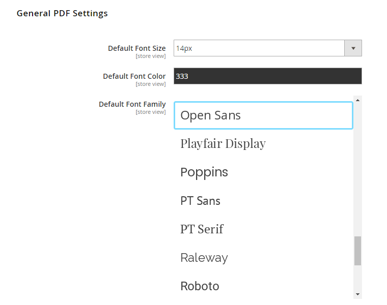

# General PDF Settings

In the General PDF Settings Section you can:

- Select a default font size and color, which will be used for the product descriptions in the PDF's main content area.
- Choose a default font family used in the product page PDF. You can choose to use the default font family for all PDF content, or choose a custom font family for the PDF header, product title and price, section headings and footer pagination.

---

[Documentation index](./README.md) · [README](../README.md) · [Online version](https://plugin.company/knowledge-base/docs/magento2-product-page-pdf/user-manual/general-pdf-settings/)
