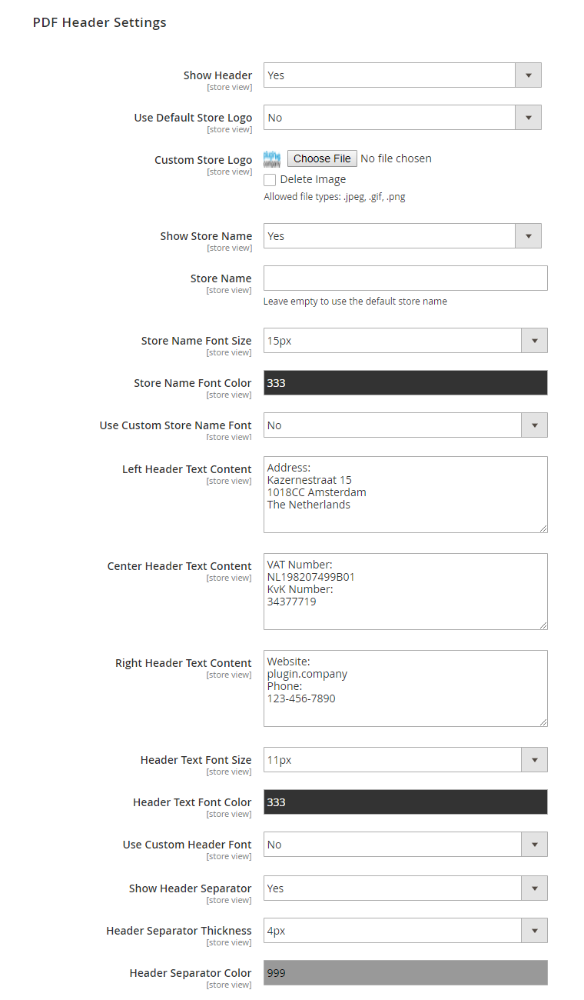

# PDF Header Settings

In the PDF Header Settings you can:

- Optionally add a header to your product PDF by enabling the 'Show Header' option.
- Choose to show the default store logo or an uploaded logo in the left corner or the header.
- Choose to show the default or a custom store name on the left side of the header, underneath the store logo.
- Optionally add text content to be shown in the left, center and right header column.
- Customize the store name and header font size, color and font family.
- Choose to show a header separator line and adjust its thickness (in px) and color.

---

[Documentation index](./README.md) · [README](../README.md) · [Online version](https://plugin.company/knowledge-base/docs/magento2-product-page-pdf/user-manual/pdf-header-settings/)
