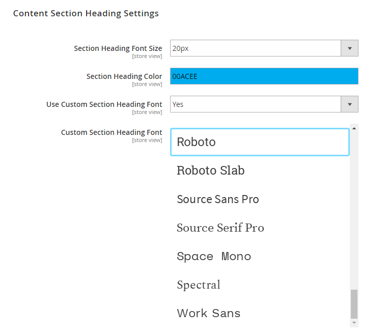
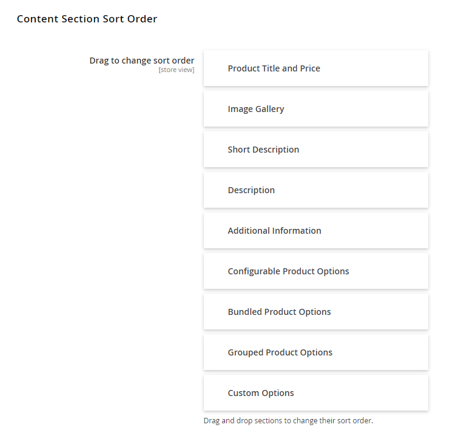
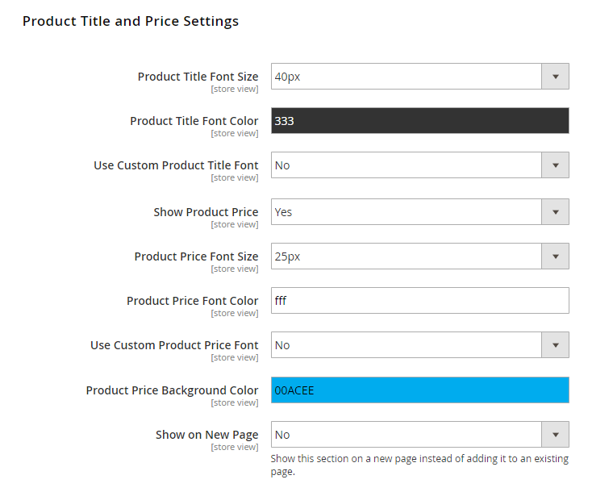
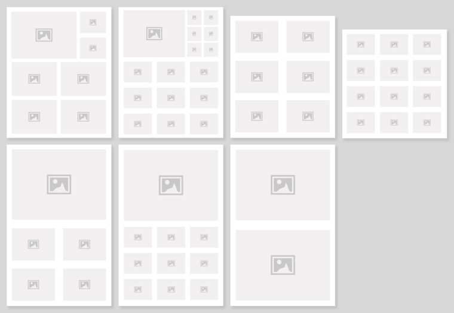
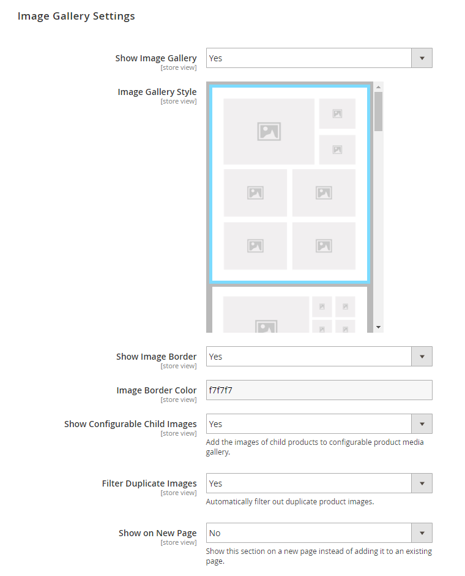

# PDF Content Section Settings

Using the options below you can configure the sections, style and sort order of the product page PDF main content area (see [front-end examples](./12-frontend-examples.md)).

You can individually enable the following sections of the product page and choose to show each section on a new page instead of adding it to an existing page:

- [Product Title and Price](#title-price)
- [Image Gallery](#gallery)
- Short Description
- Product Description
- Additional Information
- Configurable Product Options
- Bundle Product Options
- Grouped Product Options
- Custom Options

In case the enabled sections aren't applicable to certain products, they will be automatically hidden in the PDF.

By enabling the 'Hide Empty Attributes' option it's also possible to hide product attributes with no value in the Additional Information section.

## Content Section Heading Settings

This section lets you customize the font size, color and font family of the headings used for the various product PDF content sections.

## Content Section Sort Order

By dragging and dropping the product page sections, you can change their sort order in the PDF.

## Product Title and Price Settings

You can customize the font size, color and family of the product title and price and change the product price background color.

## Image Gallery Settings

Using the Image Gallery Settings you can:

- Choose one of the following 7 image gallery styles:

  
- Optionally add a border around the product images and change its color.
- Choose to add the images of child products to the configurable product media gallery.
- Choose to automatically filter out duplicate product images.

---

[Documentation index](./README.md) · [README](../README.md) · [Online version](https://plugin.company/knowledge-base/docs/magento2-product-page-pdf/user-manual/pdf-content-section-settings/)
