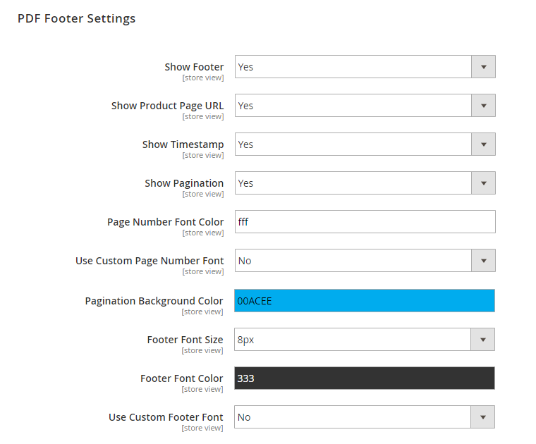

# PDF Footer Settings

In the PDF Footer Settings you can:

- Optionally add a footer to your product page by enabling the 'Show Footer' option.
- Choose to show the product page URL, a time stamp and page numbers in the PDF footer.
- Use a custom footer and page number font size, color and font family and change the pagination background color.

---

[Documentation index](./README.md) · [README](../README.md) · [Online version](https://plugin.company/knowledge-base/docs/magento2-product-page-pdf/user-manual/pdf-footer-settings/)
