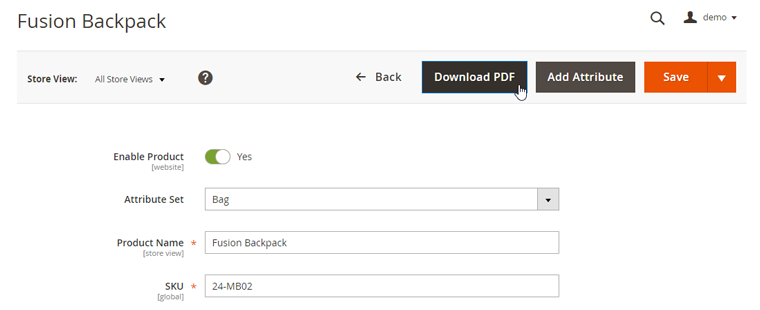

# Downloading Product PDFs from the Admin Panel

As of v100.4.0, the extension enables admin users to download the product page PDF directly from the product admin page.

To download the product PDF from the back-end, select a product by navigating to **Products > Catalog** in the Admin Panel and clicking the 'Download PDF' button at the top of the product view.

---

[Documentation index](./README.md) · [README](../README.md) · [Online version](https://plugin.company/knowledge-base/docs/magento2-product-page-pdf/user-manual/downloading-product-pdfs-from-the-admin-panel/)
