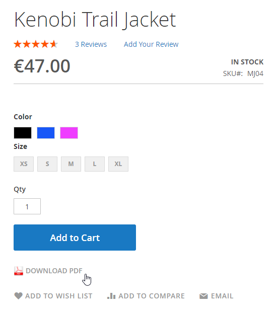
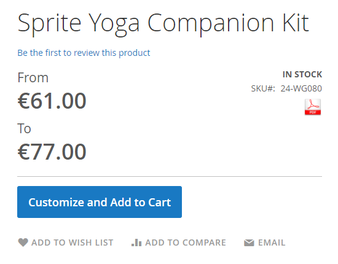
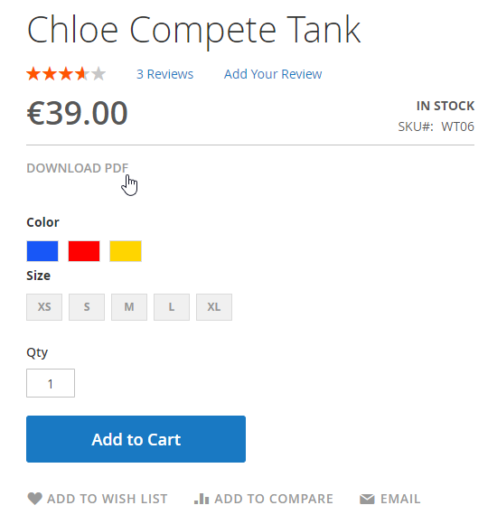
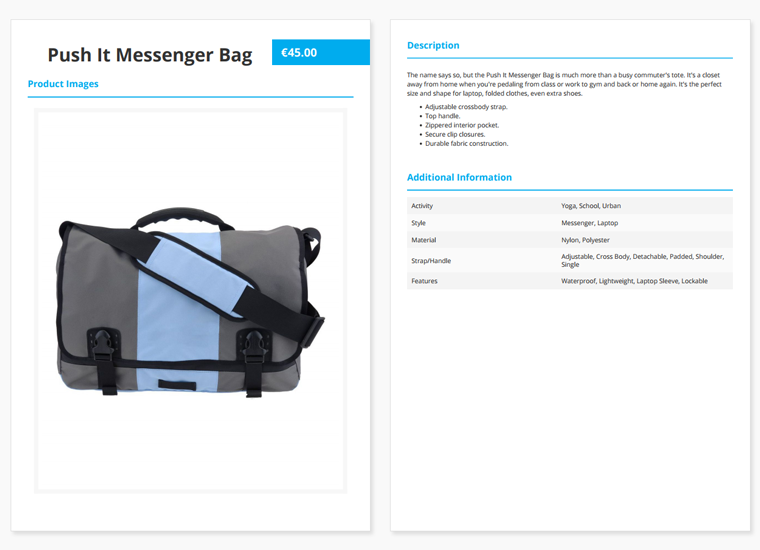
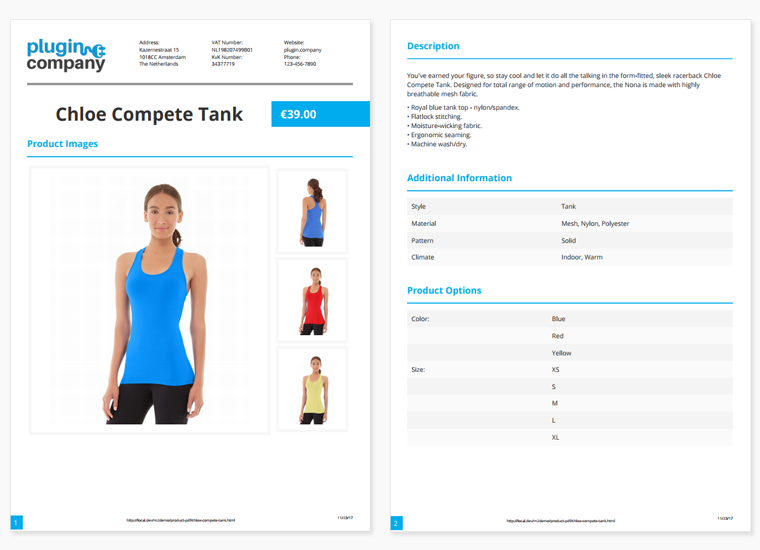
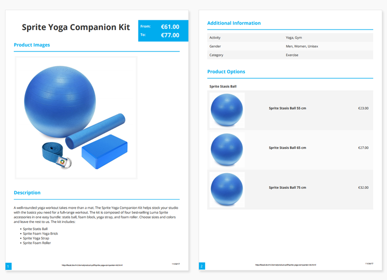
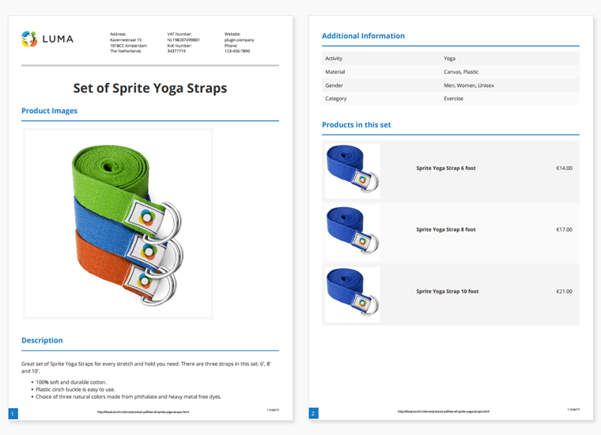

# Product Page PDF Front-end Examples

Below are a couple of examples of the extension's front-end display settings and PDF layout and design options.

## Product Page PDF Download Icon / Link

Example of PDF download icon and text link placed after the Add to Cart button.

Example of PDF download icon appended to the product Stock / SKU block.

Example of PDF download link placed under the Product Price Section.

## Simple Product Page PDF

Example of a simple product page PDF without header and footer. The various sections of the product page can be sorted and rearranged in the PDF using a simple drag and drop system.

## Configurable Product Page PDF

Example of a configurable product PDF with header and footer. The header can contain a custom logo, company name and up to three columns with text content. The footer may include pagination, the product page URL and a time stamp.

## Bundle Product Page PDF

Example of a bundle product page PDF showing the product options (page 1-2 of 3).

## Grouped Product

Example of a grouped product page PDF with header and footer.

---

[Documentation index](./README.md) · [README](../README.md) · [Online version](https://plugin.company/knowledge-base/docs/magento2-product-page-pdf/user-manual/frontend-examples/)
