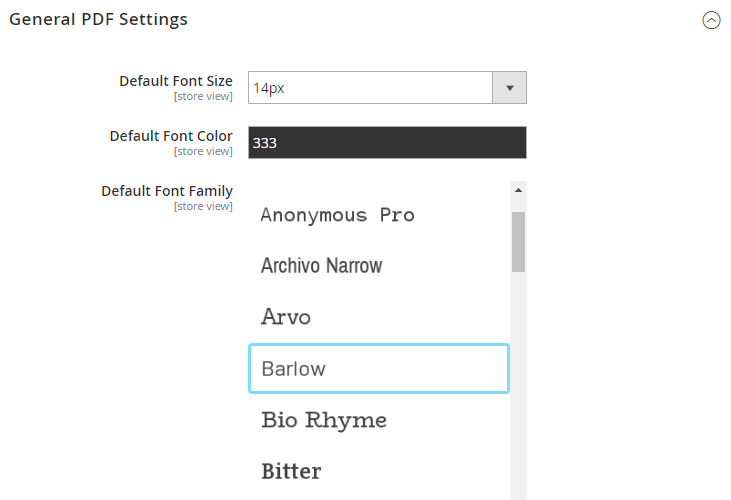

# Adding a Custom Font

It's relatively straightforward to add a custom font to use with our Product PDF Extension. Below we'll explain the steps needed to add the custom font named `Barlow`.

## Step 1: Prepare the font for upload

Adding a new font is as simple as preparing a directory with the font files in it, and uploading it to a specific directory on the Magento server.

The font directory should be named the same as the name of the font in lowercase with no spaces. In this case it would be `barlow`.

### Font directory contents:

Ideally the font directory should contain the following files:

- METADATA.pb file
- Regular font file in TTF format
- Bold font file in TTF format
- Italic font file in TTF format
- Bold Italic font file in TTF format

The minimum requirements for the font directory are:

- METADATA.pb file
- Regular font file in TTF format
- Bold font file in TTF format

(In case there's no bold font file available, you could add the regular font file twice instead)

### Font directory file names

For the `Barlow` font, the directory would contain the following files:

`Barlow-Regular.ttf`

`Barlow-Bold.ttf`

`Barlow-Italic.ttf`

`Barlow-BoldItalic.ttf`

`METADATA.pb`

When adding a different custom font, you can simply replace `Barlow` with your font name.

### METADATA.pb file

The METADATA.pb file is a simple text file with the following contents:

`name: "Barlow"`

## Step 2: Upload the font directory to your server

After completing step 1, you are ready to upload the created font directory to your server.

In our example we'll upload the folder named `barlow` to the following directory:

`MAGENTO_ROOT/pub/media/plugincompany/productpdf/googlefonts`

(The folder named `barlow` contains all the fonts + the METADATA.pb file, and should now be located inside the `googlefonts` directory)

## Step 3: Check if the font is available

Now you can go to the Magento admin panel to check if the new font is available in the font picker when configuring your PDF. It should be there now!

## Extra: Example Font Files

The Barlow font used in this example, including its `METADATA.pb` file and the TTF files, is available in the [Google Fonts repository on GitHub](https://github.com/google/fonts/tree/main/ofl/barlow).

---

[Documentation index](./README.md) · [README](../README.md) · [Online version](https://plugin.company/knowledge-base/docs/magento2-product-page-pdf/user-manual/adding-a-custom-font/)
